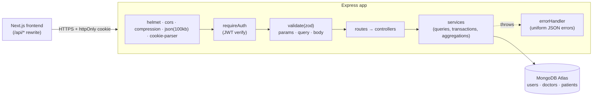

# Doctor Tracker: API

> **Live API:** _https://doctor-tracker-api.onrender.com/api/health_ (update after deploy) · **Frontend repo:** [doctor-tracker-web](https://github.com/MohammadSiam/doctor-tracker-web) · **Live app:** _https://doctor-tracker.vercel.app_
>
> **Demo login:** `admin@doctortracker.com` / `Admin@123`

## Description

The REST API behind Doctor Tracker, a secure admin portal for managing doctors and their patients. It's a standalone Express 5 + TypeScript service on MongoDB that provides cookie-based JWT authentication, CRUD for doctors and patients, and fast search, filter and pagination backed by purpose-built compound indexes. Dashboard analytics come from aggregation pipelines that answer in a single round trip. All input is validated with zod, every error returns a consistent JSON shape, and doctor patient counts stay consistent through MongoDB transactions.

## Tech stack

Node.js ≥ 20 · Express 5 · TypeScript · MongoDB Atlas + Mongoose 9 · zod 4 · jsonwebtoken + bcryptjs · helmet · express-rate-limit · compression · morgan

## Setup guide

**Prerequisites:** Node.js ≥ 20, pnpm (`corepack enable`), and a MongoDB **replica set** (MongoDB Atlas free tier works; transactions need a replica set).

```bash
# 1. Clone and install
git clone https://github.com/MohammadSiam/doctor-tracker-api.git
cd doctor-tracker-api
pnpm install

# 2. Configure the environment
cp .env.example .env
#    Set MONGODB_URI (include the db name, e.g. /doctor_tracker) and a 32+ char JWT_SECRET:
#    openssl rand -hex 32

# 3. Create indexes, the admin user and demo data (60 doctors, ~3,000 patients)
pnpm seed
#    Custom size: pnpm seed --doctors=100 --patients=10000

# 4. Start
pnpm dev                    # http://localhost:5000/api/health

# Production
pnpm build && pnpm start
```

> ⚠️ `pnpm seed` **deletes all doctors and patients** before inserting demo data. The admin user is upserted, so it isn't duplicated.

| Variable | Required | Description |
|---|---|---|
| `MONGODB_URI` | ✅ | Atlas connection string including the database name |
| `JWT_SECRET` | ✅ | ≥ 32 characters, used to sign session tokens |
| `JWT_EXPIRES_IN` | | Session length, default `7d` |
| `PORT` | | Default `5000` (Render sets this itself) |
| `CORS_ORIGINS` | | Comma-separated browser origins allowed to call the API directly |
| `ADMIN_EMAIL` / `ADMIN_PASSWORD` | | Admin account created by `pnpm seed` |
| `NODE_ENV` | | `production` enables `Secure` cookies and turns off auto-indexing |

Environment variables are validated with zod at startup. The process refuses to boot with a clear message when something is missing.

**Deploying to Render:** "New → Blueprint" picks up `render.yaml`; or create a Web Service with build command `corepack enable && pnpm install --frozen-lockfile --prod=false && pnpm build`, start command `pnpm start`, and health check path `/api/health`. Set `MONGODB_URI`, `JWT_SECRET` and `CORS_ORIGINS`. In Atlas, allow Render's outbound IPs (or `0.0.0.0/0` for a demo).
**Cold starts:** Render's free tier sleeps after 15 minutes idle. A cron-job.org / UptimeRobot monitor hitting `GET /api/health` every 10 minutes keeps it awake.

## System architecture



The code is organized by feature. Each module has `schema` (zod) → `routes` → `controller` (HTTP only) → `service` (data access), so business logic never touches `req`/`res`:

```
src/
├── config/        env.ts (validated env) · db.ts
├── middleware/    auth.ts · validate.ts · error.ts
├── models/        User · Doctor · Patient (+ indexes)
├── modules/
│   ├── auth/      login · logout · me
│   ├── doctors/   CRUD · filters · lookup · nested patients
│   ├── patients/  CRUD
│   └── stats/     overview · timeseries
├── utils/         ApiError · pagination · search · validators
├── scripts/seed.ts
├── app.ts         express app factory
└── server.ts      boot + graceful shutdown
```

## API reference

All routes except `/api/health` and `/api/auth/login` require authentication: the `dt_token` cookie, or `Authorization: Bearer <token>`.

| Method | Endpoint | Description |
|---|---|---|
| `GET` | `/api/health` | Liveness + DB status (used by Render and the keep-alive ping) |
| `POST` | `/api/auth/login` | `{ email, password }` → sets the httpOnly cookie, returns the user. Rate-limited (20 failed attempts / 15 min) |
| `POST` | `/api/auth/logout` | Clears the cookie |
| `GET` | `/api/auth/me` | Current user |
| `GET` | `/api/doctors` | List. Query: `page, limit(≤100), search, specialization, hospital, from, to, sort` |
| `POST` | `/api/doctors` | Create `{ name, specialization, hospital, phone, email }` |
| `GET` / `PATCH` / `DELETE` | `/api/doctors/:id` | Read / partial update / delete (also deletes the doctor's patients, in a transaction) |
| `GET` | `/api/doctors/filters` | Distinct specializations and hospitals for filter dropdowns |
| `GET` | `/api/doctors/lookup?search=` | Up to 20 `{ _id, name, specialization, hospital }` for comboboxes |
| `GET` | `/api/doctors/:id/patients` | Patients of one doctor (same query params as `/patients`) |
| `POST` | `/api/doctors/:id/patients` | Add a patient under this doctor |
| `DELETE` | `/api/doctors/:id/patients/:patientId` | Remove a patient from this doctor's list (404 if they belong to someone else) |
| `GET` | `/api/patients` | List. Query: `page, limit, search, condition, gender, doctor, from, to, sort` |
| `POST` | `/api/patients` | Create `{ name, age, gender, phone, email?, condition, diagnosis, notes?, admittedAt?, doctor }` |
| `GET` / `PATCH` / `DELETE` | `/api/patients/:id` | Read / update (moving to another doctor updates both counts) / delete |
| `GET` | `/api/stats/overview` | Totals, growth, condition / gender / age breakdowns, specializations, top 10 doctors |
| `GET` | `/api/stats/timeseries?range=7d\|30d\|90d\|12m` | Admissions, critical admissions and new doctors per day (or month), gaps filled with 0 |

**Response shapes**

```jsonc
// list
{ "success": true, "data": [ ... ], "meta": { "page": 1, "limit": 10, "total": 3000, "totalPages": 300 } }
// single
{ "success": true, "data": { ... } }
// error (400 / 401 / 403 / 404 / 409 / 429 / 500)
{ "success": false, "message": "Validation failed",
  "details": [{ "path": "body.email", "message": "Enter a valid email" }] }
```

## Technical decisions

### 1. Index-backed prefix search on a token array, instead of `$regex: /term/i` or `$text`

Search has to work as you type ("rah" should find "Dr. Rahim Saha") across name, email, hospital and phone.

- **`{ name: /rah/i }`**: an unanchored, case-insensitive regex can't use an index, so it's a full collection scan that slows down linearly with data. Searching four fields with `$or` multiplies that.
- **`$text` index**: matches whole stemmed words only, so typing "rah" finds nothing until the full word is typed. That's poor UX for an admin table.
- **Atlas Search**: the best option at scale, but it's Atlas-only infrastructure and overkill here.

**Chosen:** each document stores `searchTokens`, a lowercase array of the words in name, email, hospital and phone, built in a `pre('save')` hook and in the seeder. It has a multikey index. The query turns every search word into an **anchored, case-sensitive prefix regex** (`/^rah/`), which MongoDB answers as an **index range scan**. Several words use `$all`, so "dr ra" means both prefixes must match.

### 2. Compound indexes designed per query (ESR rule) + a denormalized `patientCount`

Every list query has the form *filter by equality → sort by date → page*. Each index follows the **Equality, Sort, Range** rule and ends with `_id`, which is also the sort tiebreaker. That keeps pagination stable when dates tie, and lets the index alone provide the sort order:

| Query | Index |
|---|---|
| default doctor list, joined-date range | `{ createdAt: -1, _id: -1 }` |
| doctors by specialization / hospital | `{ specialization: 1, createdAt: -1, _id: -1 }`, `{ hospital: 1, createdAt: -1, _id: -1 }` |
| patients list, admission-date range | `{ admittedAt: -1, _id: -1 }` |
| patients by condition | `{ condition: 1, admittedAt: -1, _id: -1 }` |
| a doctor's patients, group-by-doctor | `{ doctor: 1, admittedAt: -1, _id: -1 }` |
| search | `{ searchTokens: 1 }` (multikey) |
| top doctors chart | `{ patientCount: -1 }` |

Verified with `explain("executionStats")` on the seeded data:

```
doctors default    IXSCAN(createdAt_-1__id_-1)                       returned 10, docsExamined 10
doctors spec.      IXSCAN(specialization_1_createdAt_-1__id_-1)      returned 8,  docsExamined 8
patients condition IXSCAN(condition_1_admittedAt_-1__id_-1)          returned 10, docsExamined 10
patients of doctor IXSCAN(doctor_1_admittedAt_-1__id_-1)             returned 10, docsExamined 10
patients search    IXSCAN(searchTokens_1) → SORT                     returned 10, docsExamined 69
```

Before `_id` was added to the condition index, the planner fell back to the date index and examined **153 documents for 10 results**. Afterwards it's **10 for 10**: no collection scans and no in-memory sorts, except for search, where sorting a small matched set is expected.

**`patientCount` is denormalized** on each doctor, so the doctor list, the top-doctors chart and the specialization chart never need a `$lookup` or a `$group` over patients. It stays correct because every operation that changes it (create, move, delete patient, delete doctor) runs in a **MongoDB transaction** that writes the patient and `$inc`s the counter together. Other optimizations: `.lean()` reads, `find` + `countDocuments` run in parallel, `populate` on a page fetches all doctors in one `$in` query, the dashboard runs its independent queries with `Promise.all`, and a single `$facet` pass covers the condition, gender and age breakdowns.

**Scaling further:** offset pagination costs grow with `skip`. Past ~100k rows, the next step is cursor pagination (`createdAt < lastSeen`), which the `(field, _id)` indexes already support. Dashboard results could also be cached for 30 to 60 seconds.

## Security

- bcrypt (cost 12) password hashes, excluded from queries by default (`select: false`)
- JWT in an httpOnly, `SameSite=Lax`, `Secure` (in production) cookie; also accepts `Bearer` tokens for API clients
- Login rate limiting that only counts failed attempts; the same error message for an unknown email and a wrong password (no user enumeration)
- helmet security headers, CORS allow-list, 100 kB JSON body limit
- zod validation of params, query and body, plus `ObjectId` format checks; regex input is escaped
- Uniform error handler: stack traces only outside production; Mongo duplicate-key, cast and validation errors become clean 4xx responses
